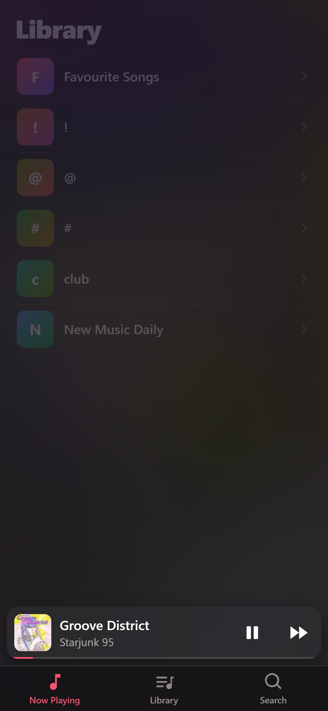
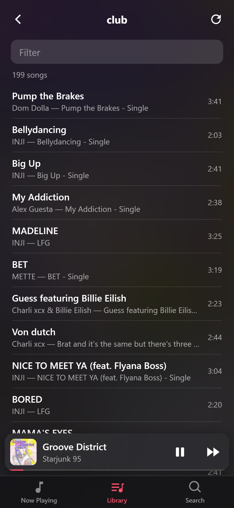

# Apple Music Remote for Windows

Control the **Apple Music app on Windows** from your phone — like Apple's
iTunes Remote app, which Apple Music for Windows doesn't support.

A single-file Python server that hosts a mobile-friendly web remote on your
local network:

- **Now playing** — artwork, title, artist, album, blurred-artwork backdrop
- **Live updates** — the phone follows track, position, volume and
  shuffle/repeat changes the moment they happen, including ones made on the PC
- **Transport** — play/pause, next/previous, smooth progress bar, plus a mini
  player that stays on screen while you browse
- **Seeking** — drag the progress bar to jump within the track
- **Volume** — system volume slider and mute
- **Shuffle & repeat** — toggle shuffle, cycle repeat off/all/one
- **Playlist browser** — list your playlists, browse and filter tracks, tap to play
- **Search** — search the Apple Music catalog and play any song
- **Up Next** — see the current play queue

No accounts, no cloud, no Electron — one Python file and a handful of
packages, or a single `.exe` if you'd rather not install Python.

## Screenshots

| Now playing | Library | Playlist | Playing next |
|---|---|---|---|
|  |  |  |  |

## Why this exists

The iPhone Remote app talks DACP, which iTunes for Windows supported but the
new Apple Music app does not. Apple Music also has no public API on Windows.
This project bridges the gap with Windows-native mechanisms instead:

| Feature | Mechanism |
|---|---|
| Playback state, metadata, artwork, play/pause/next/prev | SMTC ([`winrt`](https://github.com/pywinrt/pywinrt)) |
| System volume / mute | Core Audio ([`pycaw`](https://pypi.org/project/pycaw/)) |
| Seek, shuffle, repeat, playlists | UI Automation ([`uiautomation`](https://pypi.org/project/uiautomation/)) |

Apple Music ignores SMTC seek/shuffle/repeat requests and exposes no library
access, so those features drive the app's own window through accessibility
(UIA) patterns — no mouse or keyboard simulation, so it won't fight your
cursor.

## Requirements

- Windows 10/11 with the [Apple Music app](https://apps.microsoft.com/detail/9pfhdd62mxs1)
- A phone on the same Wi-Fi network

## Install

### Option 1: download the app (no Python needed)

1. Download `AppleMusicRemote.exe` from the
   [latest release](https://github.com/ahmetberber/windows-apple-music-remote/releases/latest).
2. Run it. The first time, Windows may ask two things:
   - SmartScreen may say "Windows protected your PC", because the file is not
     code-signed. Choose **More info** → **Run anyway**. The executable is
     built from this repository by the
     [release workflow](.github/workflows/release.yml). Each release also
     lists `AppleMusicRemote.exe.sha256`; check that it matches before you
     run the file:
     `(Get-FileHash .\AppleMusicRemote.exe).Hash`.
   - Windows Firewall asks whether to allow access. Allow it on **private**
     networks only, or your phone will not be able to connect.
3. Open the address it prints on your phone. It ends in `?k=…`, the access
   key; see [Access key](#access-key).

To start it with Windows, press <kbd>Win</kbd>+<kbd>R</kbd>, enter
`shell:startup`, and put a shortcut to the `.exe` in the folder that opens.

### Option 2: run from source

Needs Python 3.11 or later.

```powershell
pip install -r requirements.txt

# Allow inbound connections once (admin PowerShell):
# Private networks only: not on public Wi-Fi such as cafés or hotels.
New-NetFirewallRule -DisplayName "Apple Music Remote" -Direction Inbound -Protocol TCP -LocalPort 8765 -Profile Private -Action Allow

python apple-music-remote.py            # or --port 1234
```

## Use

Open the printed URL on your phone. On iOS, use Safari's **Add to Home
Screen** for a fullscreen app-like experience.

### Access key

The printed URL ends in `?k=…`. That key is what lets a phone in: without
it, the server answers every request with "Access key needed". The phone
keeps the key in a cookie after the first visit, so bookmarks and Home Screen
icons keep working.

- The key is created on first run and kept in
  `%APPDATA%\AppleMusicRemote\key.txt`, so it stays the same across
  restarts.
- Anyone who has the full address can control playback. If you shared it by
  mistake, start the app with `--new-key`: every phone then has to open the
  newly printed address.
- Commands are refused when they come from another website open in the
  phone's browser, so a web page cannot control the remote for you.

Apple Music must be running (play something once so its media session
exists).

## Limitations

- **Plain HTTP on your local network.** The access key keeps out devices that
  don't have it, but the traffic, the key included, is not encrypted, so
  someone who can watch your Wi-Fi traffic can read it. Use the remote on
  networks you trust, and don't expose the port beyond your local network.
- Opening a playlist from the phone also navigates the Apple Music window on
  the PC (that's how the UIA bridge works).
- Track lists are cached (on the server until it restarts, and on the phone)
  so playlists open instantly; tap the reload button in a playlist to re-read
  it after you change it in Apple Music.
- Built and tested with Apple Music's interface in **English**. Search finds
  the sections of the results page by their English names ("Songs", "Top
  Results"), so it is expected not to work in other languages, and the repeat
  state is read from the button's English name, so it may display as off
  (the button itself still works). Everything else uses language-independent
  identifiers but has not been tested in another language. Reports and fixes
  for other languages are welcome.
- Search returns the "Songs" section of the results page (the top handful of
  matches), and the Up Next view is read-only — Apple Music's queue rows
  don't respond to programmatic activation.
- The first read of a playlist takes a few seconds (roughly one second per
  hundred tracks), since virtualized list rows are collected while scrolling.

## How it stays responsive

- Each Windows mechanism runs on its own long-lived worker thread that keeps
  its COM/WinRT objects alive, instead of rebuilding them per request.
- The server subscribes to SMTC events and pushes state to the phone over
  Server-Sent Events (`/events`), so there is no polling and the UI updates
  the moment Windows reports a change.
- UI Automation searches run inside the UIA core (`FindFirst`/`FindAll`), and
  list rows are read with a cache request: one cross-process call per screen
  of rows instead of dozens per row.
- `uiautomation` sleeps 0.5 s after every pattern call by default; every call
  here passes `waitTime=0` and waits for the actual effect instead.

## License

[MIT](LICENSE)
