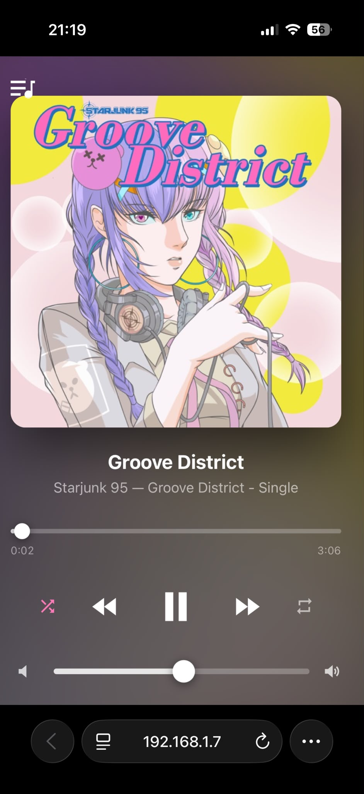
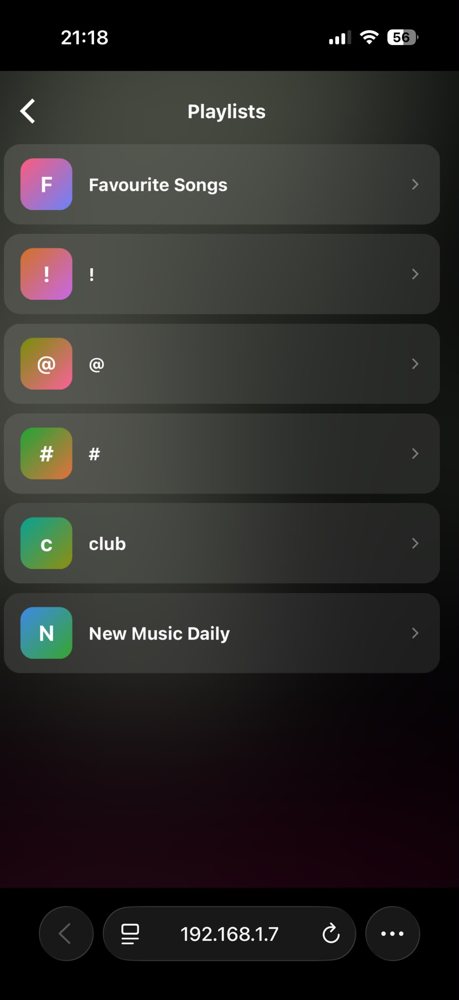
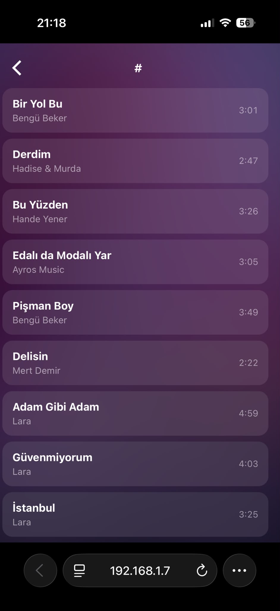

# Apple Music Remote for Windows

Control the **Apple Music app on Windows** from your phone — like Apple's
iTunes Remote app, which Apple Music for Windows doesn't support.

A single-file Python server that hosts a mobile-friendly web remote on your
local network:

- **Now playing** — artwork, title, artist, blurred-artwork backdrop
- **Transport** — play/pause, next/previous, live progress bar
- **Seeking** — drag the progress bar to jump within the track
- **Volume** — system volume slider and mute
- **Shuffle & repeat** — toggle shuffle, cycle repeat off/all/one
- **Playlist browser** — list your playlists, browse tracks, tap to play
- **Search** — search the Apple Music catalog and play any song
- **Up Next** — see the current play queue

No accounts, no cloud, no Electron — one Python file and three packages.

## Screenshots

| Now playing | Playlists | Playlist tracks |
|---|---|---|
|  |  |  |

## Why this exists

The iPhone Remote app talks DACP, which iTunes for Windows supported but the
new Apple Music app does not. Apple Music also has no public API on Windows.
This project bridges the gap with Windows-native mechanisms instead:

| Feature | Mechanism |
|---|---|
| Playback state, metadata, artwork, play/pause/next/prev | SMTC ([`winsdk`](https://pypi.org/project/winsdk/)) |
| System volume / mute | Core Audio ([`pycaw`](https://pypi.org/project/pycaw/)) |
| Seek, shuffle, repeat, playlists | UI Automation ([`uiautomation`](https://pypi.org/project/uiautomation/)) |

Apple Music ignores SMTC seek/shuffle/repeat requests and exposes no library
access, so those features drive the app's own window through accessibility
(UIA) patterns — no mouse or keyboard simulation, so it won't fight your
cursor.

## Requirements

- Windows 10/11 with the [Apple Music app](https://apps.microsoft.com/detail/9pfhdd62mxs1)
- Python 3.10+
- A phone on the same Wi-Fi network

## Setup

```powershell
pip install -r requirements.txt

# Allow inbound connections once (admin PowerShell):
New-NetFirewallRule -DisplayName "Apple Music Remote" -Direction Inbound -Protocol TCP -LocalPort 8765 -Action Allow
```

## Run

```powershell
python apple-music-remote.py            # or --port 1234
```

Open the printed URL on your phone. On iOS, use Safari's **Add to Home
Screen** for a fullscreen app-like experience.

Apple Music must be running (play something once so its media session
exists).

## Limitations

- **No authentication** — anyone on your LAN can control playback. Don't
  expose the port beyond your local network.
- Opening a playlist from the phone also navigates the Apple Music window on
  the PC (that's how the UIA bridge works).
- Track lists are cached until the server restarts; use `/tracks/<n>?fresh`
  to force a re-read.
- Repeat/shuffle state is read from the English UI's accessible names; on
  other UI languages the buttons still work but state may display as off.
- Search returns the "Songs" section of the results page (the top handful of
  matches), and the Up Next view is read-only — Apple Music's queue rows
  don't respond to programmatic activation.
- First read of a very large playlist (1000+ tracks) is slow, since
  virtualized list rows are collected while scrolling.

## License

[MIT](LICENSE)
