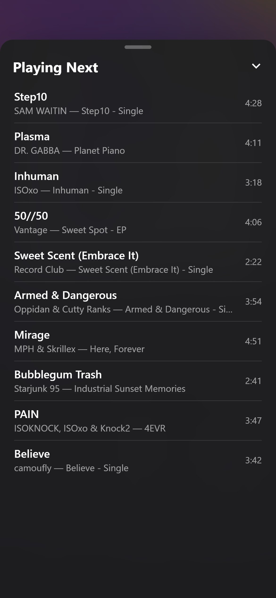

# Apple Music Remote for Windows

Control the **Apple Music app on Windows** from your phone — like Apple's
iTunes Remote app, which Apple Music for Windows doesn't support.

A single-file Python server that hosts a mobile-friendly web remote on your
local network:

- **Now playing** — artwork, title, artist, album, blurred-artwork backdrop
- **Live updates** — the phone follows track, position, volume and
  shuffle/repeat changes the moment they happen, including ones made on the PC
- **Transport** — play/pause, next/previous, smooth progress bar, plus a mini
  player that stays on screen while you browse
- **Seeking** — drag the progress bar to jump within the track
- **Volume** — system volume slider and mute
- **Shuffle & repeat** — toggle shuffle, cycle repeat off/all/one
- **Playlist browser** — list your playlists, browse and filter tracks, tap to play
- **Search** — search the Apple Music catalog and play any song
- **Up Next** — see the current play queue

No accounts, no cloud, no Electron — one Python file and a handful of packages.

## Screenshots

| Now playing | Library | Playlist | Playing next |
|---|---|---|---|
|  |  |  |  |

## Why this exists

The iPhone Remote app talks DACP, which iTunes for Windows supported but the
new Apple Music app does not. Apple Music also has no public API on Windows.
This project bridges the gap with Windows-native mechanisms instead:

| Feature | Mechanism |
|---|---|
| Playback state, metadata, artwork, play/pause/next/prev | SMTC ([`winrt`](https://github.com/pywinrt/pywinrt)) |
| System volume / mute | Core Audio ([`pycaw`](https://pypi.org/project/pycaw/)) |
| Seek, shuffle, repeat, playlists | UI Automation ([`uiautomation`](https://pypi.org/project/uiautomation/)) |

Apple Music ignores SMTC seek/shuffle/repeat requests and exposes no library
access, so those features drive the app's own window through accessibility
(UIA) patterns — no mouse or keyboard simulation, so it won't fight your
cursor.

## Requirements

- Windows 10/11 with the [Apple Music app](https://apps.microsoft.com/detail/9pfhdd62mxs1)
- Python 3.11+
- A phone on the same Wi-Fi network

## Setup

```powershell
pip install -r requirements.txt

# Allow inbound connections once (admin PowerShell):
New-NetFirewallRule -DisplayName "Apple Music Remote" -Direction Inbound -Protocol TCP -LocalPort 8765 -Action Allow
```

## Run

```powershell
python apple-music-remote.py            # or --port 1234
```

Open the printed URL on your phone. On iOS, use Safari's **Add to Home
Screen** for a fullscreen app-like experience.

Apple Music must be running (play something once so its media session
exists).

## Limitations

- **No authentication** — anyone on your LAN can control playback. Don't
  expose the port beyond your local network.
- Opening a playlist from the phone also navigates the Apple Music window on
  the PC (that's how the UIA bridge works).
- Track lists are cached (on the server until it restarts, and on the phone)
  so playlists open instantly; tap the reload button in a playlist to re-read
  it after you change it in Apple Music.
- Repeat/shuffle state is read from the English UI's accessible names; on
  other UI languages the buttons still work but state may display as off.
- Search returns the "Songs" section of the results page (the top handful of
  matches), and the Up Next view is read-only — Apple Music's queue rows
  don't respond to programmatic activation.
- The first read of a playlist takes a few seconds (roughly one second per
  hundred tracks), since virtualized list rows are collected while scrolling.

## How it stays responsive

- Each Windows mechanism runs on its own long-lived worker thread that keeps
  its COM/WinRT objects alive, instead of rebuilding them per request.
- The server subscribes to SMTC events and pushes state to the phone over
  Server-Sent Events (`/events`), so there is no polling and the UI updates
  the moment Windows reports a change.
- UI Automation searches run inside the UIA core (`FindFirst`/`FindAll`), and
  list rows are read with a cache request: one cross-process call per screen
  of rows instead of dozens per row.
- `uiautomation` sleeps 0.5 s after every pattern call by default; every call
  here passes `waitTime=0` and waits for the actual effect instead.

## License

[MIT](LICENSE)
